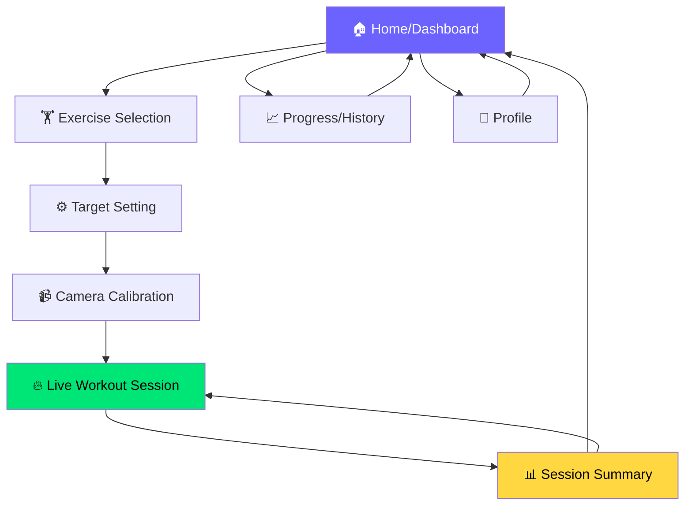

# 🎨 FitTrack — Frontend UI/UX Plan

## 📋 Daftar Isi
1. [Tech Stack & Arsitektur Frontend](#tech-stack)
2. [Design System](#design-system)
3. [Navigasi & Routing](#navigasi)
4. [Screen-by-Screen Breakdown](#screens)
5. [Component Architecture](#components)
6. [Responsive Strategy](#responsive)
7. [Micro-interactions & Animations](#animations)

---

## 1. Tech Stack & Arsitektur Frontend {#tech-stack}

| Layer | Teknologi | Alasan |
|-------|-----------|--------|
| Framework | **Vite + Vanilla JS** (atau React jika mau scalable) | Ringan, cepat, cocok untuk real-time webcam |
| Styling | **Vanilla CSS** dengan CSS Custom Properties | Fleksibel, dark mode support, no dependency |
| Camera/Pose | **MediaPipe Pose (JS SDK)** + Canvas API | Langsung di browser, tanpa backend Python |
| Charts | **Chart.js** | Ringan, animasi bagus, mudah dikustomisasi |
| Storage | **localStorage / IndexedDB** | MVP tanpa backend, data tetap persist |
| Icons | **Lucide Icons** (CDN) | Modern, lightweight, konsisten |
| Font | **Google Fonts — Inter** | Clean, modern, sangat readable |

> [!IMPORTANT]
> Keputusan kunci: **Full browser-based** (bukan Python desktop). Ini berarti MediaPipe JS SDK langsung di browser, bukan OpenCV + Python. Alasan: lebih mudah di-deploy, UI modern dengan HTML/CSS, dan MediaPipe JS performanya cukup bagus untuk real-time pose detection.

---

## 2. Design System {#design-system}

### 🎨 Color Palette

```
┌─────────────────────────────────────────────────────┐
│  FITTRACK DESIGN TOKENS                              │
├─────────────────────────────────────────────────────┤
│                                                      │
│  Primary Gradient:  #6C63FF → #00D9FF (Purple→Cyan) │
│  Accent (Success):  #00E676 (Neon Green)             │
│  Accent (Warning):  #FFD740 (Amber)                  │
│  Accent (Error):    #FF5252 (Coral Red)              │
│                                                      │
│  Background Dark:   #0A0E1A (Deep Navy)              │
│  Surface:           #141929 (Card background)        │
│  Surface Elevated:  #1E2438 (Modal/overlay)          │
│  Text Primary:      #F0F0F5 (Almost white)           │
│  Text Secondary:    #8B8FA3 (Muted)                  │
│  Border:            #2A2F45 (Subtle)                 │
│                                                      │
│  Skeleton Overlay:  #00E676 (pose landmarks)         │
│  Skeleton Lines:    #6C63FF (joint connections)      │
│                                                      │
└─────────────────────────────────────────────────────┘
```

> [!TIP]
> Dark theme by default karena:
> 1. Webcam feed terlihat lebih jelas di background gelap
> 2. Mengurangi distraksi visual saat latihan
> 3. Terasa lebih premium & modern

### 📐 Typography Scale

| Token | Size | Weight | Usage |
|-------|------|--------|-------|
| `--font-display` | 48px | 800 | Hero titles, rep counter besar |
| `--font-h1` | 32px | 700 | Screen titles |
| `--font-h2` | 24px | 600 | Section headers |
| `--font-h3` | 18px | 600 | Card titles |
| `--font-body` | 16px | 400 | Body text |
| `--font-small` | 14px | 400 | Labels, captions |
| `--font-micro` | 12px | 500 | Badges, tags |

### 📦 Spacing & Layout

```css
--space-xs:  4px;
--space-sm:  8px;
--space-md:  16px;
--space-lg:  24px;
--space-xl:  32px;
--space-2xl: 48px;
--space-3xl: 64px;

--radius-sm: 8px;
--radius-md: 12px;
--radius-lg: 16px;
--radius-xl: 24px;
--radius-full: 9999px;
```

### 🃏 Card & Container Style

```
╭───────────────────────────────────╮
│  background: var(--surface)       │
│  border: 1px solid var(--border)  │
│  border-radius: var(--radius-lg)  │
│  backdrop-filter: blur(12px)      │  ← Glassmorphism effect
│  box-shadow: 0 4px 24px           │
│      rgba(0,0,0,0.2)              │
╰───────────────────────────────────╯
```

---

## 3. Navigasi & Routing {#navigasi}

### 🗺️ Navigation Map



### 📱 Navigation Pattern: **Single Page Application (SPA)**

Alasan tidak pakai multi-page:
- Webcam stream harus persistent (tidak boleh restart tiap pindah halaman)
- Smooth transitions antar screen
- Data flow lebih mudah (shared state)

### 🧭 Navigation Bar (Bottom Nav - Mobile Style)

```
┌─────────────────────────────────────────────────┐
│                                                   │
│              [ SCREEN CONTENT ]                   │
│                                                   │
├────────┬────────┬────────┬────────┬──────────────┤
│  🏠    │  🏋️   │  📈    │  👤    │              │
│ Home   │ Train  │ Stats  │ Profile│              │
│        │        │        │        │              │
└────────┴────────┴────────┴────────┴──────────────┘
         ↑ Active tab = primary gradient underline
```

### Routing Table

| Route | Screen | Tab Active | Back Button? |
|-------|--------|------------|--------------|
| `/` | Home Dashboard | Home | ❌ |
| `/exercise` | Exercise Selection | Train | ← Home |
| `/exercise/setup` | Target Setting Modal | Train | ← Exercise |
| `/workout/calibrate` | Camera Calibration | — (fullscreen) | ✕ Cancel |
| `/workout/live` | Live Workout | — (fullscreen) | ⏸ Pause |
| `/workout/summary` | Session Summary | — | ← Home |
| `/progress` | Progress & History | Stats | ← Home |
| `/profile` | Profile Settings | Profile | ← Home |

> [!NOTE]
> Saat masuk mode **workout** (calibrate + live), bottom nav **disembunyikan** agar layar penuh untuk webcam. Navigasi kembali hanya lewat tombol pause/stop.

---

## 4. Screen-by-Screen Breakdown {#screens}

### Screen 1: 🏠 Home / Dashboard

```
┌──────────────────────────────────────────────┐
│  ☰                         FitTrack     👤   │  ← Top bar
├──────────────────────────────────────────────┤
│                                              │
│  ┌────────────────────────────────────────┐  │
│  │  Selamat Datang, [Nama]! 👋            │  │
│  │                                        │  │
│  │  🔥 Streak: 5 hari                     │  │
│  │  📊 Minggu ini: 12 sesi               │  │
│  │                                        │  │
│  │  ┌──────────┐  ┌──────────┐            │  │  ← Quick stats
│  │  │ Total    │  │ Avg      │            │  │
│  │  │ 847 reps │  │ Score 87%│            │  │
│  │  └──────────┘  └──────────┘            │  │
│  └────────────────────────────────────────┘  │
│                                              │
│  ┌────────────────────────────────────────┐  │
│  │  ▶ MULAI LATIHAN                       │  │  ← CTA utama
│  │    (gradient button, pulse animation)  │  │     Besar, mencolok
│  └────────────────────────────────────────┘  │
│                                              │
│  Sesi Terakhir                               │
│  ┌──────────────────────────────────────┐    │
│  │ 🏋️ Squat  │  15 reps │ ⭐ 92% │ 2m  │    │  ← Recent session
│  ├──────────────────────────────────────┤    │
│  │ 💪 Push-up │ 10 reps │ ⭐ 78% │ 3m  │    │
│  └──────────────────────────────────────┘    │
│                                              │
│  ┌────────────────────────────────────────┐  │
│  │  📈 Mini Progress Chart (7 hari)       │  │  ← Sparkline chart
│  │  ▁▃▅▇█▆▇                               │  │
│  └────────────────────────────────────────┘  │
│                                              │
├────────┬────────┬────────┬────────────────────┤
│  🏠   │  🏋️  │  📈   │  👤                  │
│ Home  │ Train │ Stats │ Profile               │
└────────┴────────┴────────┴────────────────────┘
```

**Komponen utama:**
- **Welcome Card** — Greeting + streak + weekly stats
- **Quick Stats** — 2-column grid (total reps, avg form score)
- **CTA Button** — "Mulai Latihan" gradient button dengan pulse animation
- **Recent Sessions** — List 3 sesi terakhir (scrollable)
- **Mini Chart** — Sparkline 7 hari terakhir

---

### Screen 2: 🏋️ Exercise Selection

```
┌──────────────────────────────────────────────┐
│  ← Kembali            Pilih Latihan          │
├──────────────────────────────────────────────┤
│                                              │
│  ┌────────────────────────────────────────┐  │
│  │                                        │  │
│  │  🦵                                    │  │
│  │  SQUAT                                 │  │
│  │  ─────                                 │  │
│  │  Paha & Glutes • Beginner              │  │
│  │  Target: Otot paha, bokong, core       │  │
│  │                                        │  │
│  │  [████████░░] 85% avg score            │  │  ← Personal best
│  │  Best: 25 reps                         │  │
│  │                                        │  │
│  └────────────────────────────────────────┘  │
│                                              │
│  ┌────────────────────────────────────────┐  │
│  │                                        │  │
│  │  💪                                    │  │
│  │  PUSH-UP                               │  │
│  │  ───────                               │  │
│  │  Dada & Trisep • Intermediate          │  │
│  │  Target: Dada, bahu, trisep            │  │
│  │                                        │  │
│  │  [██████░░░░] 62% avg score            │  │
│  │  Best: 18 reps                         │  │
│  │                                        │  │
│  └────────────────────────────────────────┘  │
│                                              │
│  ┌────────────────────────────────────────┐  │
│  │                                        │  │
│  │  ⭐                                    │  │
│  │  JUMPING JACK                           │  │
│  │  ────────────                           │  │
│  │  Kardio • Beginner                     │  │
│  │  Target: Full body, stamina            │  │
│  │                                        │  │
│  │  [████░░░░░░] 40% avg score            │  │
│  │  Best: 30 reps                         │  │
│  │                                        │  │
│  └────────────────────────────────────────┘  │
│                                              │
└──────────────────────────────────────────────┘
```

**Interaksi:**
- Tap/click card → buka **Target Setting Modal** (slide up)
- Card punya hover effect (scale + glow)
- Progress bar tiap exercise menunjukkan personal stats

---

### Screen 3: ⚙️ Target Setting (Bottom Sheet / Modal)

```
┌──────────────────────────────────────────────┐
│                                              │
│          (Blurred background)                │
│                                              │
│  ┌────────────────────────────────────────┐  │
│  │  ━━━━━━  (drag handle)                 │  │
│  │                                        │  │
│  │  🦵 Squat                              │  │
│  │                                        │  │
│  │  Mode Latihan:                         │  │
│  │  ┌──────────┐  ┌──────────┐            │  │
│  │  │ 🎯 Target│  │ ⏱️ Timer │            │  │  ← Toggle pills
│  │  │   Reps   │  │  Mode    │            │  │
│  │  └──────────┘  └──────────┘            │  │
│  │                                        │  │
│  │  Jumlah Repetisi:                      │  │
│  │  ┌──────┐                              │  │
│  │  │  [-]    15    [+]  │                │  │  ← Stepper
│  │  └──────┘                              │  │
│  │                                        │  │
│  │  Preset: [10] [15] [20] [30] [Custom]  │  │  ← Quick presets
│  │                                        │  │
│  │  Difficulty:                           │  │
│  │  [ Mudah ] [◉ Normal ] [ Ketat ]       │  │  ← Segmented control
│  │                                        │  │
│  │  ┌────────────────────────────────┐    │  │
│  │  │    ▶  MULAI LATIHAN            │    │  │  ← Primary CTA
│  │  │    (gradient, full width)      │    │  │
│  │  └────────────────────────────────┘    │  │
│  │                                        │  │
│  └────────────────────────────────────────┘  │
└──────────────────────────────────────────────┘
```

---

### Screen 4: 📹 Camera Calibration (Fullscreen)

```
┌──────────────────────────────────────────────┐
│  ✕ Batal                                     │
│                                              │
│  ┌────────────────────────────────────────┐  │
│  │                                        │  │
│  │                                        │  │
│  │         ┌─────────────────┐            │  │
│  │         │   📹 WEBCAM     │            │  │
│  │         │    PREVIEW      │            │  │
│  │         │                 │            │  │
│  │         │   ╭───╮         │            │  │
│  │         │   │ 🧍 │  ←pose │            │  │
│  │         │   ╰───╯  outline│            │  │
│  │         │                 │            │  │
│  │         └─────────────────┘            │  │
│  │                                        │  │
│  └────────────────────────────────────────┘  │
│                                              │
│  ┌──────────────────────────────────┐        │
│  │ ✅ Kamera aktif                   │        │
│  │ ✅ Badan terdeteksi              │        │  ← Checklist
│  │ ⏳ Pastikan badan penuh terlihat  │        │     status items
│  └──────────────────────────────────┘        │
│                                              │
│  💡 Tips: Mundur sedikit agar seluruh        │
│     badan terlihat di kamera                 │
│                                              │
│  ┌────────────────────────────────────┐      │
│  │    ▶  SIAP! MULAI (3..2..1)        │      │  ← Enabled when
│  └────────────────────────────────────┘      │     all checks ✅
│                                              │
└──────────────────────────────────────────────┘
```

**Logika Kalibrasi:**
1. Cek permission kamera → ✅/❌
2. Deteksi pose landmarks → ✅ "Badan terdeteksi"
3. Cek visibility semua landmark kunci → ✅ "Badan penuh terlihat"
4. Semua ✅ → button "SIAP!" menyala (gradient + pulse)
5. Klik → countdown 3..2..1..GO! (overlay besar di tengah)

---

### Screen 5: 🔥 Live Workout Session (FULLSCREEN — Inti Aplikasi)

```
┌──────────────────────────────────────────────────┐
│                                                    │
│  ⏸ Pause    🦵 Squat           ⏱️ 01:24           │  ← Top HUD
│                                                    │
│  ┌──────────────────────────────────────────────┐  │
│  │                                              │  │
│  │           WEBCAM FEED (Full canvas)          │  │
│  │                                              │  │
│  │              ╭─── ●  ───╮                    │  │
│  │              │    🤖     │                    │  │
│  │             /│\          │  ← Skeleton        │  │
│  │            / │ \  ● ●   │    overlay          │  │
│  │           ●  │  ●       │    (hijau neon      │  │
│  │          /   │   \      │     jika benar,     │  │
│  │         ●    │    ●     │     merah jika      │  │
│  │        /     │     \    │     salah)           │  │
│  │       ●      │      ●  │                      │  │
│  │                                              │  │
│  └──────────────────────────────────────────────┘  │
│                                                    │
│  ┌────────────────────────────────────────────┐    │
│  │                                            │    │
│  │    ┌─────────┐     ┌────────────────────┐  │    │
│  │    │         │     │                    │  │    │
│  │    │   12    │     │  ✅ Bagus!          │  │    │  ← Bottom HUD
│  │    │  ──── │     │  Pertahankan posisi │  │    │
│  │    │   15    │     │                    │  │    │
│  │    │  reps   │     │  (atau ❌ feedback  │  │    │
│  │    │         │     │   koreksi form)    │  │    │
│  │    └─────────┘     └────────────────────┘  │    │
│  │                                            │    │
│  │  [████████████░░░░░] 80%                   │    │  ← Progress bar
│  │                                            │    │
│  └────────────────────────────────────────────┘    │
│                                                    │
│       [ 🛑 SELESAI ]                               │  ← Stop button
│                                                    │
└──────────────────────────────────────────────────────┘
```

**Detail HUD (Heads-Up Display):**

| Elemen | Posisi | Detail |
|--------|--------|--------|
| Pause button | Top-left | Buka pause menu (resume/quit) |
| Exercise name | Top-center | Nama latihan aktif |
| Timer | Top-right | Durasi berjalan (mm:ss) |
| Rep Counter | Bottom-left | Besar & bold, format "current/target" |
| Feedback Card | Bottom-right | Real-time form feedback, warna berubah |
| Progress Bar | Bottom-center | Gradient fill sesuai progress |
| Stop Button | Bottom | Tombol darurat untuk selesai |

**Animasi penting:**
- **Rep count naik** → angka "pop" animation (scale up 1.5x lalu kembali)
- **Feedback berubah** → slide-in dari kanan
- **Skeleton color** → hijau (#00E676) saat form benar, merah (#FF5252) saat salah
- **Progress bar** → smooth fill animation

**Pause Menu (Overlay):**
```
┌──────────────────────────────┐
│                              │
│     ⏸ LATIHAN DIJEDA         │
│                              │
│   ┌───────────────────────┐  │
│   │  ▶ Lanjutkan          │  │
│   ├───────────────────────┤  │
│   │  🔄 Ulangi dari Awal  │  │
│   ├───────────────────────┤  │
│   │  🚪 Keluar            │  │
│   └───────────────────────┘  │
│                              │
│   12/15 reps • 01:24         │
│                              │
└──────────────────────────────┘
```

---

### Screen 6: 📊 Session Summary

```
┌──────────────────────────────────────────────┐
│                                              │
│  ← Home              Ringkasan Sesi          │
│                                              │
│  ┌────────────────────────────────────────┐  │
│  │                                        │  │
│  │      🎉 LATIHAN SELESAI!              │  │
│  │                                        │  │  ← Confetti animation
│  │      🦵 Squat                          │  │
│  │                                        │  │
│  └────────────────────────────────────────┘  │
│                                              │
│  ┌──────────┐  ┌──────────┐  ┌──────────┐  │
│  │   15     │  │  02:34   │  │   42     │  │
│  │  reps    │  │  durasi  │  │  kkal    │  │  ← 3-column stats
│  │  ✅ done │  │  ⏱️ time │  │  🔥 cal  │  │
│  └──────────┘  └──────────┘  └──────────┘  │
│                                              │
│  Form Score                                  │
│  ┌────────────────────────────────────────┐  │
│  │                                        │  │
│  │    ╭──────────╮                        │  │
│  │    │          │                        │  │
│  │    │   87%    │  ← Circular progress   │  │  ← Animated ring
│  │    │  BAGUS!  │     (animated fill)    │  │
│  │    │          │                        │  │
│  │    ╰──────────╯                        │  │
│  │                                        │  │
│  │  ✅ 13 rep sempurna                    │  │
│  │  ⚠️ 2 rep perlu perbaikan             │  │
│  │                                        │  │
│  └────────────────────────────────────────┘  │
│                                              │
│  Detail Feedback                             │
│  ┌────────────────────────────────────────┐  │
│  │ Rep 7:  ⚠️ Turun lebih dalam          │  │
│  │ Rep 11: ⚠️ Punggung membungkuk        │  │
│  └────────────────────────────────────────┘  │
│                                              │
│  ┌──────────────┐  ┌──────────────────┐      │
│  │ 🔄 Ulangi    │  │ 🏠 Kembali       │      │
│  └──────────────┘  └──────────────────┘      │
│                                              │
└──────────────────────────────────────────────┘
```

**Animasi:**
- Confetti particles saat score > 80%
- Circular progress ring animated fill (0% → actual%)
- Stats counter "count up" animation (0 → 15 reps)

---

### Screen 7: 📈 Progress / History

```
┌──────────────────────────────────────────────┐
│                                              │
│  Progress                     Filter: [All▾] │
│                                              │
│  ┌────────────────────────────────────────┐  │
│  │  Perkembangan 30 Hari                  │  │
│  │                                        │  │
│  │  reps                                  │  │
│  │  25│          ╭─╮                      │  │
│  │  20│    ╭─╮   │ │  ╭─╮                 │  │  ← Bar/line chart
│  │  15│╭─╮ │ │╭─╮│ │╭─╮│ │                │  │
│  │  10││ │ │ ││ ││ ││ ││ │                │  │
│  │   5││ │ │ ││ ││ ││ ││ │                │  │
│  │   0├┴─┴─┴─┴┴─┴┴─┴┴─┴┴─┤               │  │
│  │    Mon Tue Wed Thu Fri Sat              │  │
│  │                                        │  │
│  └────────────────────────────────────────┘  │
│                                              │
│  ┌────────────────────────────────────────┐  │
│  │  Statistik Keseluruhan                 │  │
│  │  ┌────────┐ ┌────────┐ ┌────────┐     │  │
│  │  │ 47     │ │ 847    │ │ 82%    │     │  │
│  │  │ sesi   │ │ reps   │ │ avg    │     │  │
│  │  │ total  │ │ total  │ │ score  │     │  │
│  │  └────────┘ └────────┘ └────────┘     │  │
│  └────────────────────────────────────────┘  │
│                                              │
│  Riwayat Latihan                             │
│  ┌────────────────────────────────────────┐  │
│  │ 📅 8 Okt 2026                          │  │
│  │ 🦵 Squat • 15 reps • 87% • 2:34       │  │
│  ├────────────────────────────────────────┤  │
│  │ 📅 7 Okt 2026                          │  │
│  │ 💪 Push-up • 10 reps • 78% • 3:01     │  │
│  ├────────────────────────────────────────┤  │
│  │ 📅 7 Okt 2026                          │  │
│  │ ⭐ Jumping Jack • 30 reps • 92% • 1:45│  │
│  └────────────────────────────────────────┘  │
│                                              │
├────────┬────────┬────────┬────────────────────┤
│  🏠   │  🏋️  │  📈   │  👤                  │
└────────┴────────┴────────┴────────────────────┘
```

---

### Screen 8: 👤 Profile

```
┌──────────────────────────────────────────────┐
│                                              │
│  Profil                                      │
│                                              │
│  ┌────────────────────────────────────────┐  │
│  │         ╭──────╮                       │  │
│  │         │  👤  │                       │  │
│  │         ╰──────╯                       │  │
│  │         User Name                      │  │
│  │         Bergabung: Okt 2026            │  │
│  └────────────────────────────────────────┘  │
│                                              │
│  Info Fisik                                  │
│  ┌────────────────────────────────────────┐  │
│  │ Tinggi:  [170] cm                      │  │
│  │ Berat:   [65]  kg                      │  │
│  │ Usia:    [25]  tahun                   │  │
│  └────────────────────────────────────────┘  │
│                                              │
│  Pengaturan                                  │
│  ┌────────────────────────────────────────┐  │
│  │ 📷 Kamera              [Default ▾]    │  │
│  │ 🔊 Suara Feedback      [●━━━━━━━]     │  │
│  │ 🎚️ Difficulty          [Normal  ▾]    │  │
│  │ 🌙 Dark Mode           [━━━━━━●]  ON  │  │
│  └────────────────────────────────────────┘  │
│                                              │
│  ┌────────────────────────────────────────┐  │
│  │ 🗑️ Hapus Semua Data                   │  │
│  └────────────────────────────────────────┘  │
│                                              │
└──────────────────────────────────────────────┘
```

---

## 5. Component Architecture {#components}

### 🧩 Component Tree

```
App
├── BottomNav                    # Tab navigation
├── TopBar                       # Dynamic title + back button
│
├── Pages/
│   ├── HomePage
│   │   ├── WelcomeCard
│   │   ├── QuickStats
│   │   ├── CTAButton
│   │   ├── RecentSessions
│   │   └── MiniChart
│   │
│   ├── ExercisePage
│   │   └── ExerciseCard (×3)
│   │       ├── ExerciseIcon
│   │       ├── ProgressBar
│   │       └── PersonalBest
│   │
│   ├── WorkoutFlow/              # Fullscreen flow
│   │   ├── TargetModal           # Bottom sheet overlay
│   │   │   ├── ModePills
│   │   │   ├── RepStepper
│   │   │   └── DifficultySelector
│   │   │
│   │   ├── CalibrationScreen
│   │   │   ├── CameraPreview
│   │   │   ├── ChecklistItem (×3)
│   │   │   └── CountdownOverlay
│   │   │
│   │   ├── LiveWorkoutScreen
│   │   │   ├── WebcamCanvas       # Pose overlay
│   │   │   ├── HUD
│   │   │   │   ├── RepCounter
│   │   │   │   ├── Timer
│   │   │   │   ├── FeedbackCard
│   │   │   │   └── ProgressBar
│   │   │   ├── PauseMenu
│   │   │   └── StopButton
│   │   │
│   │   └── SummaryScreen
│   │       ├── CompletionBanner
│   │       ├── StatsGrid
│   │       ├── FormScoreRing
│   │       ├── FeedbackList
│   │       └── ActionButtons
│   │
│   ├── ProgressPage
│   │   ├── ProgressChart
│   │   ├── OverallStats
│   │   └── SessionHistory
│   │
│   └── ProfilePage
│       ├── AvatarSection
│       ├── PhysicalInfoForm
│       └── SettingsPanel
│
└── Shared/
    ├── Button (primary, secondary, ghost, danger)
    ├── Card
    ├── Badge
    ├── Modal
    ├── ProgressBar
    ├── Toggle
    ├── Stepper
    └── Toast
```

---

## 6. Responsive Strategy {#responsive}

### Breakpoints

| Breakpoint | Width | Layout |
|-----------|-------|--------|
| Mobile | < 640px | Single column, bottom nav, stacked cards |
| Tablet | 640–1024px | 2-column grid, webcam centered |
| Desktop | > 1024px | Sidebar nav, webcam + HUD side-by-side |

### Webcam Layout Adaptations

```
MOBILE (portrait):
┌──────────┐
│ Webcam   │  ← 16:9 aspect
│ (full w) │
├──────────┤
│ HUD      │  ← Below webcam
│ Counter  │
│ Feedback │
└──────────┘

DESKTOP (landscape):
┌─────────────────┬──────────┐
│                 │  Timer   │
│    Webcam       │  Counter │  ← Side panel
│    (large)      │  Feedback│
│                 │  Progress│
│                 │  Stop    │
└─────────────────┴──────────┘
```

---

## 7. Micro-interactions & Animations {#animations}

### 🎬 Key Animations

| Trigger | Animation | Duration | Easing |
|---------|-----------|----------|--------|
| Page transition | Slide + fade | 300ms | `ease-out` |
| Rep counted | Counter pop (scale 1→1.5→1) | 400ms | `elastic` |
| Feedback change | Slide-in from right | 250ms | `ease-out` |
| Button hover | Scale 1.02 + glow | 200ms | `ease` |
| Card hover | Lift (translateY -4px) + shadow | 200ms | `ease` |
| Countdown (3..2..1) | Scale in + fade | 1000ms each | `ease-in-out` |
| Confetti (summary) | Particle burst | 2000ms | physics-based |
| Progress ring fill | Stroke-dashoffset | 1500ms | `ease-out` |
| Skeleton overlay | Real-time (per frame) | 33ms (30fps) | linear |
| Toast notification | Slide up + fade in | 300ms | `ease-out` |
| Modal open | Slide up + backdrop blur | 350ms | `cubic-bezier` |

### 🔊 Audio Feedback (Optional)

| Event | Sound |
|-------|-------|
| Rep counted | Soft "ding" |
| Countdown tick | Clock tick |
| Countdown GO! | Energetic start sound |
| Workout complete | Achievement chime |
| Error/warning | Subtle alert |

---

## 📌 Ringkasan Keputusan Desain

| Keputusan | Pilihan | Alasan |
|-----------|---------|--------|
| Platform | Web (browser-based) | Mudah deploy, cross-platform, modern UI |
| Theme | Dark by default | Webcam feed lebih jelas, premium feel |
| Nav pattern | Bottom tabs + fullscreen workout | Mobile-first, familiar UX |
| Pose library | MediaPipe JS | Browser-native, no backend needed |
| Data storage | localStorage/IndexedDB | MVP tanpa server |
| Chart library | Chart.js | Ringan, animasi bagus |
| Design style | Glassmorphism + neon accents | Modern, fitness-app aesthetic |

> [!WARNING]
> **Performance concern:** MediaPipe Pose di browser bisa berat di perangkat low-end. Pertimbangkan:
> - Option untuk memilih model `lite` vs `full`
> - Menurunkan resolusi webcam jika performa rendah
> - Menampilkan FPS counter di debug mode
